# ReX

[繁體中文](README.md) | English

An Android/iOS real-time dashboard, data recorder and live-tuning app for aRacer RC X series ECUs.

**Unofficial** third-party tool, not affiliated with aRacer. It only reads unless you press a dashboard control or start live tuning yourself. It never changes passwords or flashes firmware.

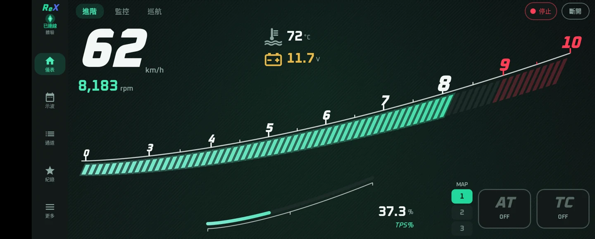

| Advanced | Cruise | Monitor |
| :---: | :---: | :---: |
| 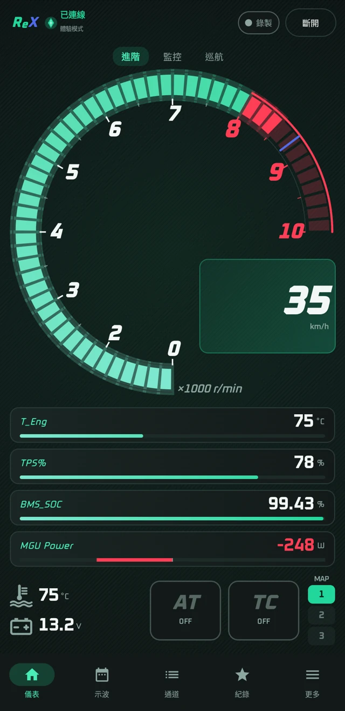 | 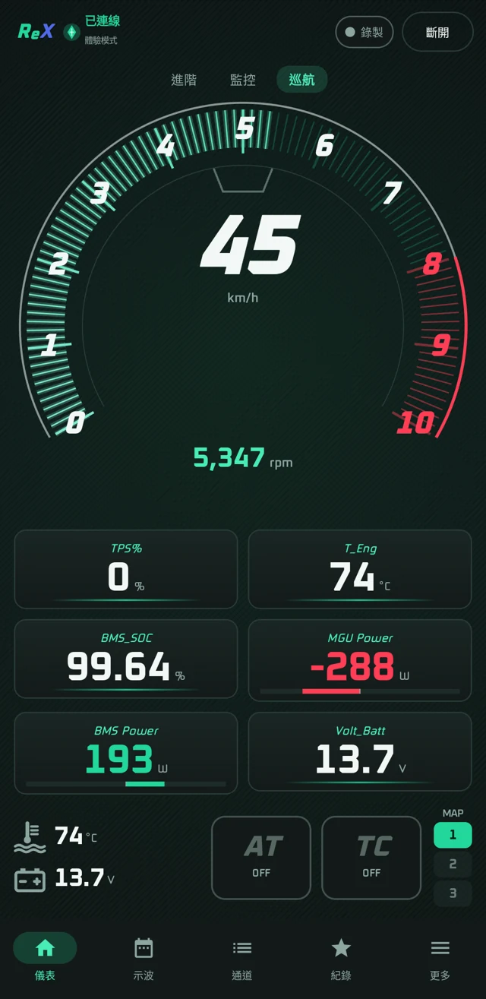 | 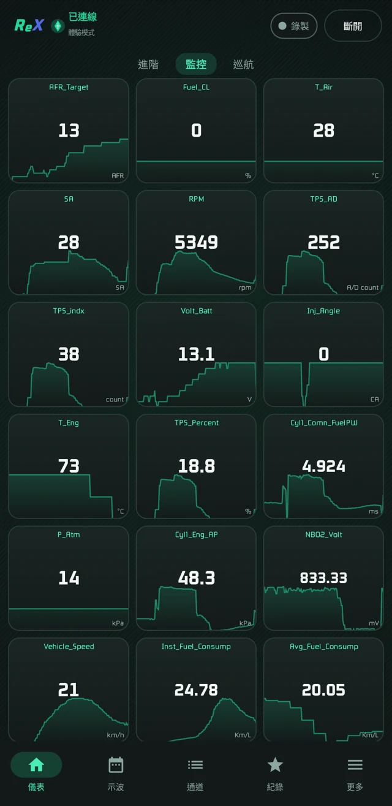 |

<details>
<summary>More screenshots</summary>

| Multi-channel scope | Channel list |
| :---: | :---: |
| 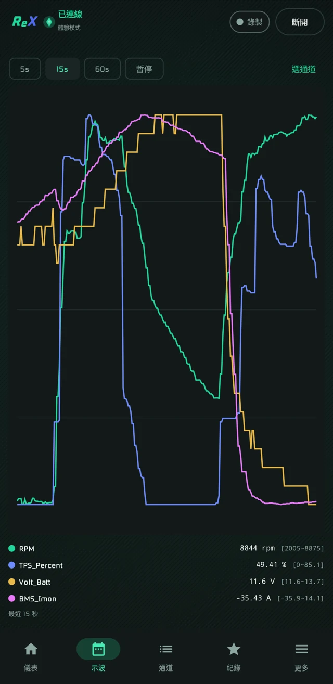 | 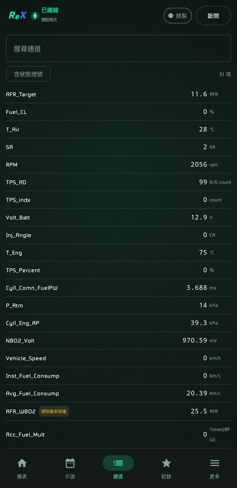 |

| Dark theme | Light theme |
| :---: | :---: |
| 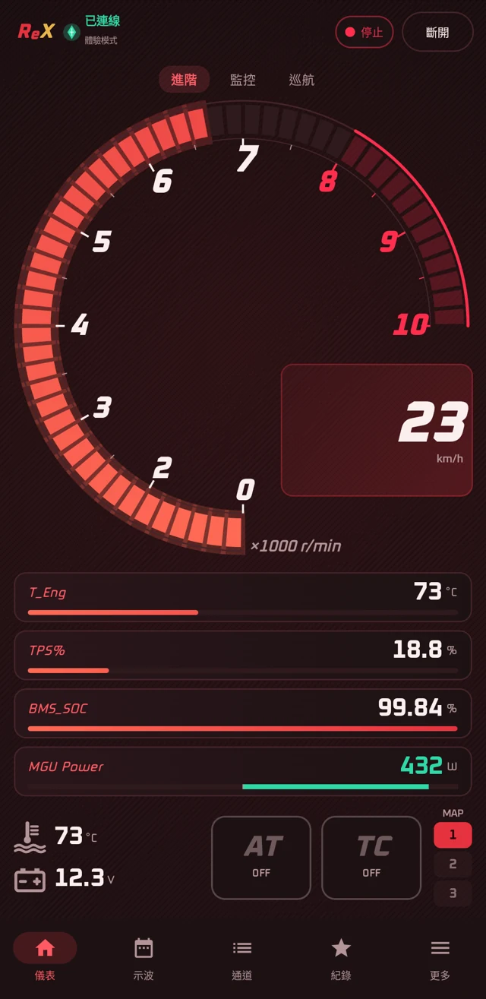 | 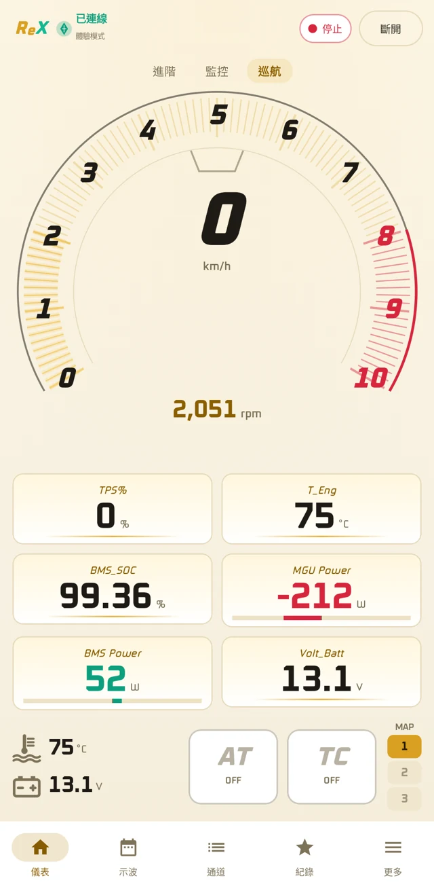 |

| Recordings | Settings |
| :---: | :---: |
| 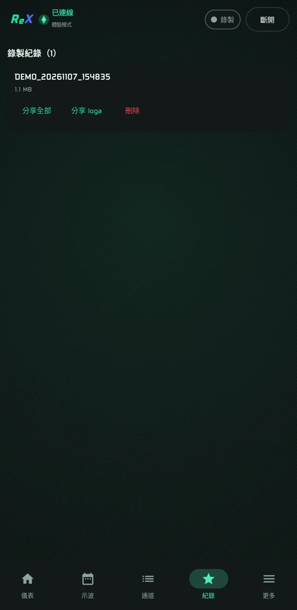 | 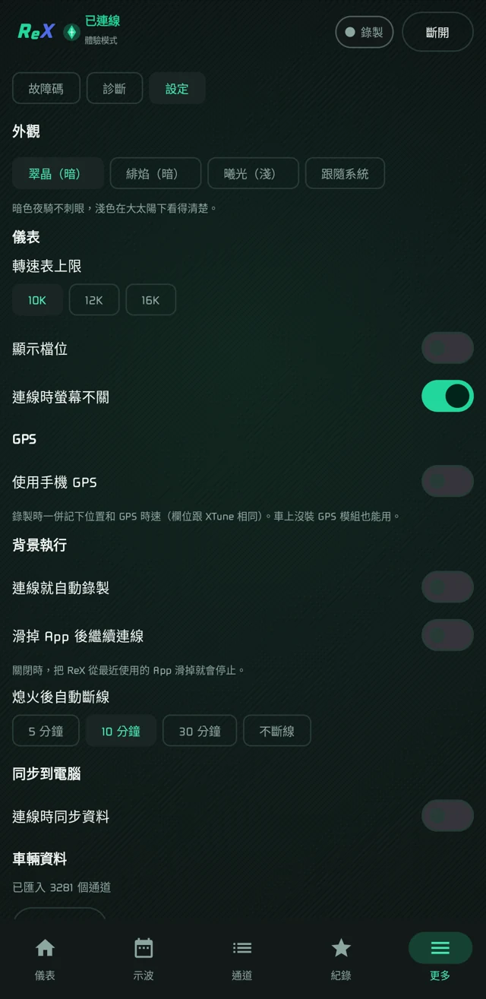 |

| Live tuning | Table list |
| :---: | :---: |
| 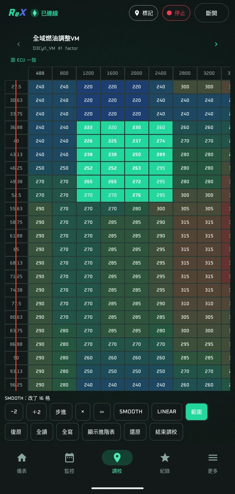 | 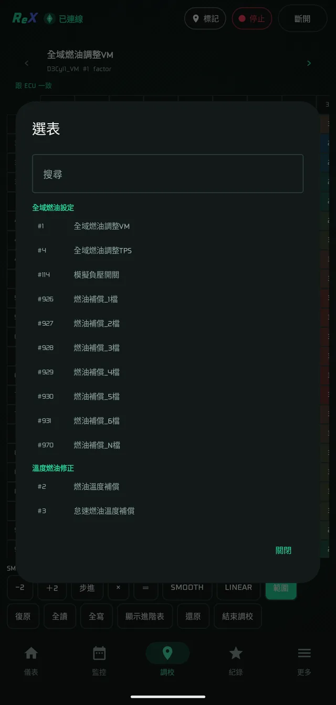 |

</details>

## Features

- Three dashboard layouts, six-channel scope, channel list and trouble codes
- `.loga` recording (XTune-compatible) with offline playback
- Dashboard controls MAP / AT / Pit / LC / TC / EB (depending on ECU model and licensing)
- Live tuning: maps, single values and switches, written about 1.2 s after you stop editing and read back to confirm; the map shows where the engine is running
- Function pages: idle, TPS learning, quick shifter, eBoost, backfire, auto warm-up, auto tune and more (depending on ECU model)
- Pairs with the desktop app [XenoBrex](https://github.com/xeno-hf/XenoBrex) to get tuning packs and upload recordings (encrypted connection)
- Automatic ECU discovery, reconnection, phone GPS speed
- English, Traditional Chinese, Simplified Chinese, Japanese

## Get started

1. Download the Android APK or unsigned iOS IPA from [Releases](https://github.com/xeno-hf/ReX/releases/latest). For iOS, use a tool such as AltStore or Sideloadly to sign and install it with your own Apple ID. No compilation is required; the IPA cannot be installed by opening it directly.
2. Join the ECU Wi-Fi, open ReX and tap Connect. Or import a `.loga` for offline playback.

ReX includes common monitoring channels for each model and switches automatically to match the connected ECU, so no files are needed. To see every channel, you can import your own ControlFile XML in Settings.

Live tuning needs a tuning pack (the table definitions): install XenoBrex on a computer, import your own definition files, then pair and sync from More → Sync to computer. ReX ships no definition files or keys.

Requires Android 10+ / iOS 15+ (iPhone/iPad). Pairing with XenoBrex, and therefore live tuning, is Android-only for now. Monitoring and dashboard controls have been tested on a real vehicle only with the Android version and a Mini X; iOS vehicle connectivity, other models and **live-tuning writes on a real vehicle remain unverified**.

## Build

Requires JDK 17+ and the Android SDK (Platform 35).

```sh
./gradlew :app:assembleRelease
```

The default release build uses a debug key unless you configure your own signing.

iOS requires macOS and Xcode and produces an unsigned IPA; sign it with your own Apple ID:

```sh
./rx-ios/app/build.sh device
```

## Safety

- Every outgoing frame passes a write gate (`rx-session/src/commonMain/kotlin/rx/session/WriteGate.kt`). Normally only reads and dashboard controls pass; tuning-pack tables and function-page commands pass only after you start live tuning. Password changes, flashing and firmware operations are always blocked.
- Starting live tuning first reads the whole calibration back from the ECU; writes are enabled only after the backup has been saved and read back. If the backup cannot be saved, tuning does not start.
- The tuning pack's platform, version (V/C) and vehicle code (Table ID) must all match the ECU. Disconnecting, reconnecting or switching ECUs revokes write access immediately; start tuning again to continue.
- Tables the ECU refuses are no longer sent. Restore first switches off the ECU's self-learning (auto tune, Pro auto tune, wideband closed loop) and confirms it is off, re-reads every table backed up at the start, rewrites the ones that differ or are uncertain and reads them back, then returns self-learning to its backed-up setting. It lists any table it could not restore.
- Changing tables changes how the engine runs. Tune somewhere safe with the vehicle stopped; you are responsible for your settings.
- Connecting configures the ECU's broadcast channels; XTune restores its own on next connect.
- Use at your own risk. Keep your eyes on the road while riding.

## License

GPL-3.0; see [LICENSE](LICENSE). The Oxanium font is under the SIL Open Font License. See [NOTICE.md](NOTICE.md) for trademark notices.
