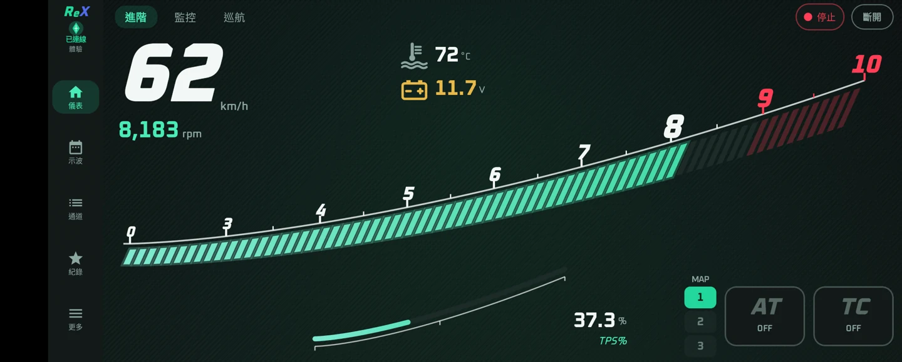
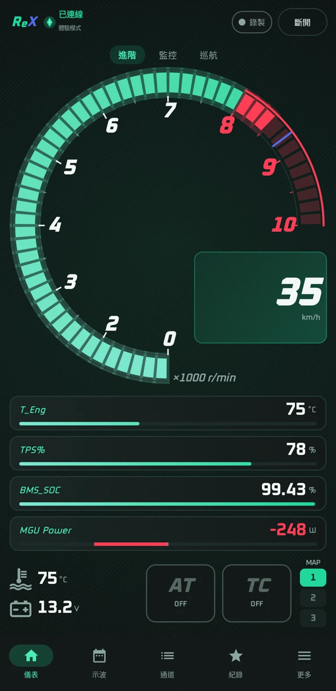
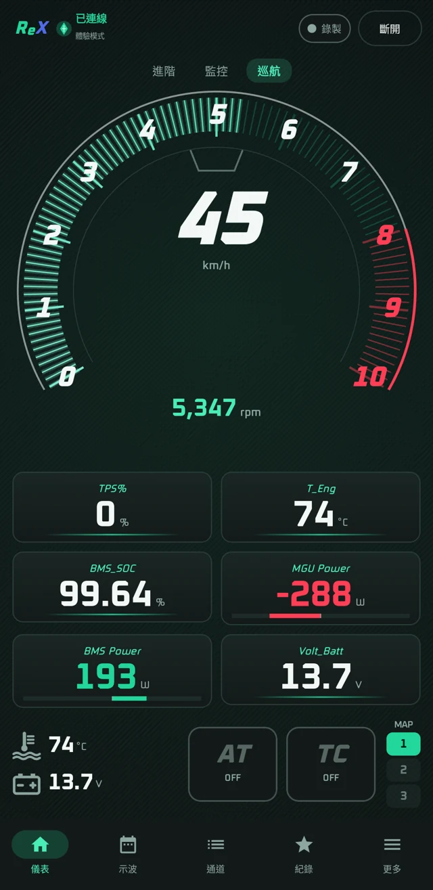
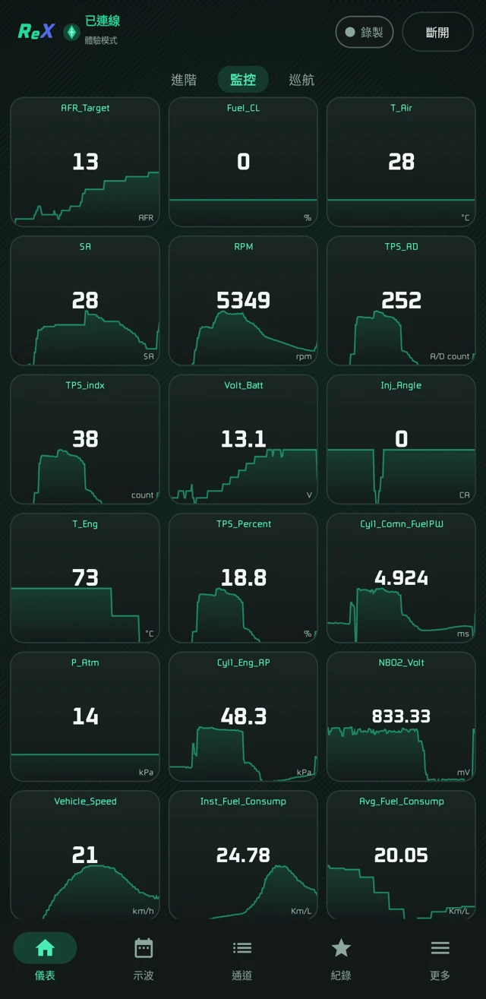
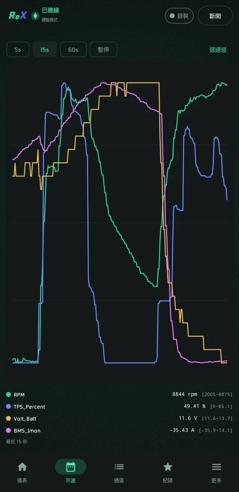
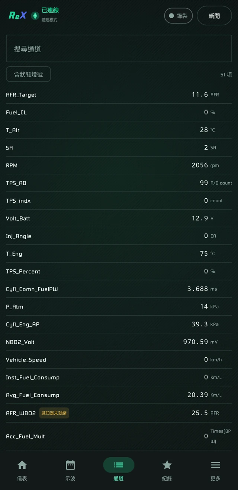
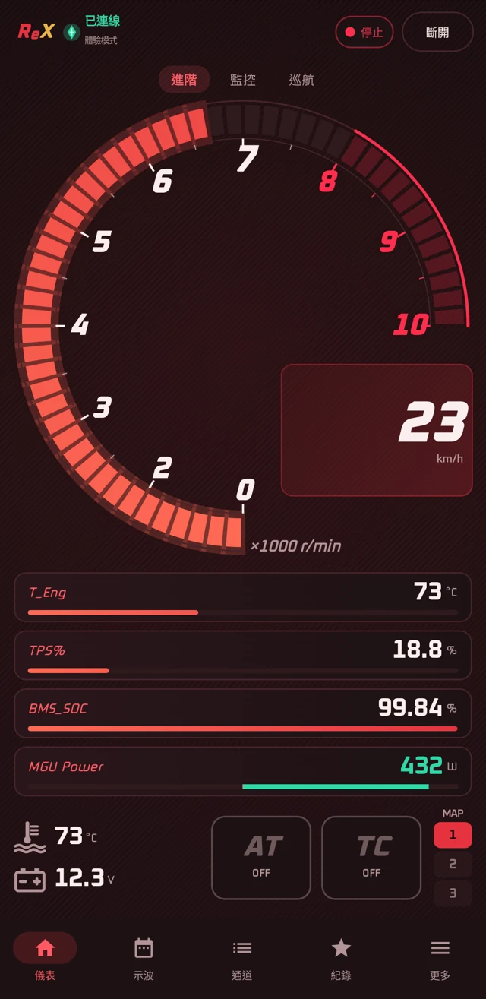
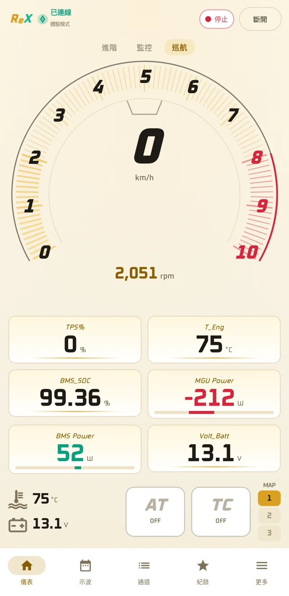
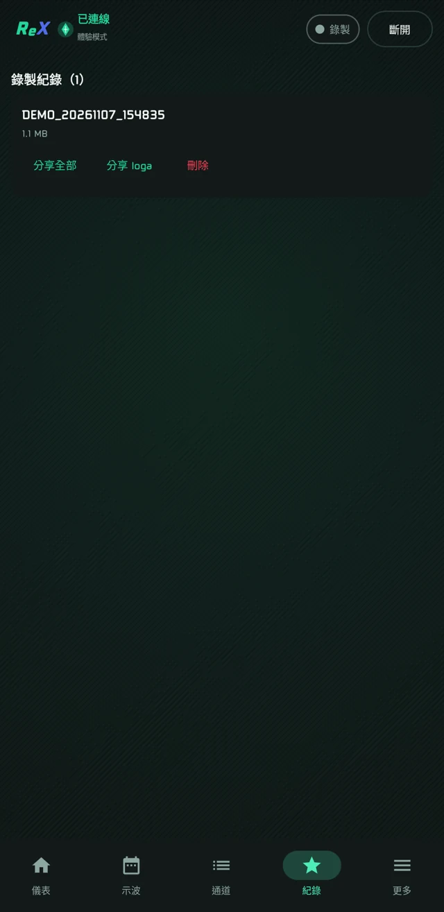
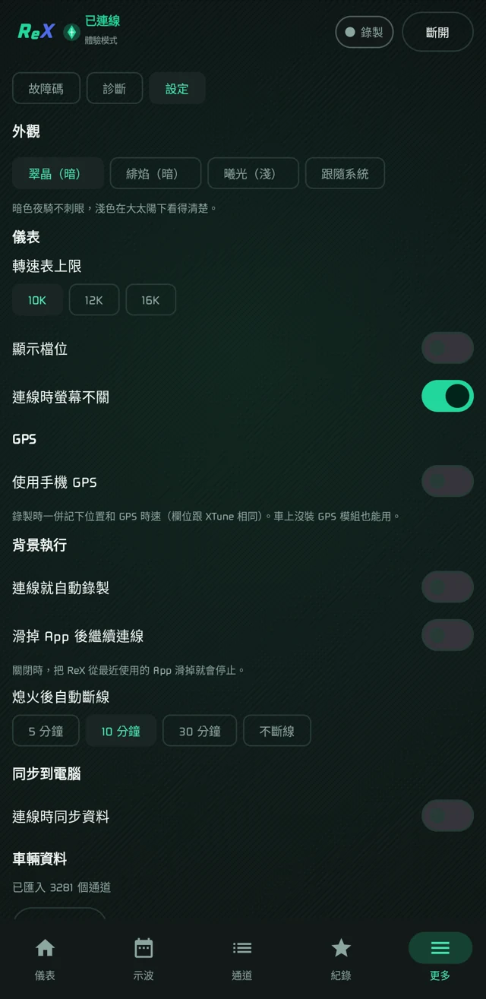

# ReX

[繁體中文](README.md) | English

An Android/iOS real-time dashboard and data recorder for aRacer RC X series ECUs.

**Unofficial** third-party tool, not affiliated with aRacer. It only monitors and records — no tuning-map, password, or firmware changes.



| Advanced | Cruise | Monitor |
| :---: | :---: | :---: |
|  |  |  |

<details>
<summary>More screenshots</summary>

| Multi-channel scope | Channel list |
| :---: | :---: |
|  |  |

| Dark theme | Light theme |
| :---: | :---: |
|  |  |

| Recordings | Settings |
| :---: | :---: |
|  |  |

</details>

## Features

- Three dashboard layouts, six-channel scope, channel list and trouble codes
- `.loga` recording (XTune-compatible) with offline playback
- Dashboard controls MAP / AT / Pit / LC / TC / EB (depending on ECU model and licensing)
- Automatic ECU discovery, reconnection, phone GPS speed
- English, Traditional Chinese, Simplified Chinese, Japanese

## Get started

1. Download the Android APK or unsigned iOS IPA from [Releases](https://github.com/xeno-hf/ReX/releases/latest). For iOS, use a tool such as AltStore or Sideloadly to sign and install it with your own Apple ID. No compilation is required; the IPA cannot be installed by opening it directly.
2. Join the ECU Wi-Fi, open ReX and tap Connect. Or import a `.loga` for offline playback.

ReX includes common monitoring channels for each model and switches automatically to match the connected ECU, so no files are needed. To see every channel, you can import your own ControlFile XML in Settings.

Requires Android 10+ / iOS 15+ (iPhone/iPad). Only the Android version with Mini X has been tested on a real vehicle so far; iOS vehicle connectivity and other models remain unverified.

## Build

Requires JDK 17+ and the Android SDK (Platform 35).

```sh
./gradlew :app:assembleRelease
```

The default release build uses a debug key unless you configure your own signing.

iOS requires macOS and Xcode and produces an unsigned IPA; sign it with your own Apple ID:

```sh
./rx-ios/app/build.sh device
```

## Safety

- Calibration writes, password changes, flashing and firmware operations are blocked before sending (`rx-session/src/commonMain/kotlin/rx/session/WriteGate.kt`).
- Connecting configures the ECU's broadcast channels; XTune restores its own on next connect.
- Use at your own risk. Keep your eyes on the road while riding.

## License

GPL-3.0; see [LICENSE](LICENSE). The Oxanium font is under the SIL Open Font License. See [NOTICE.md](NOTICE.md) for trademark notices.
