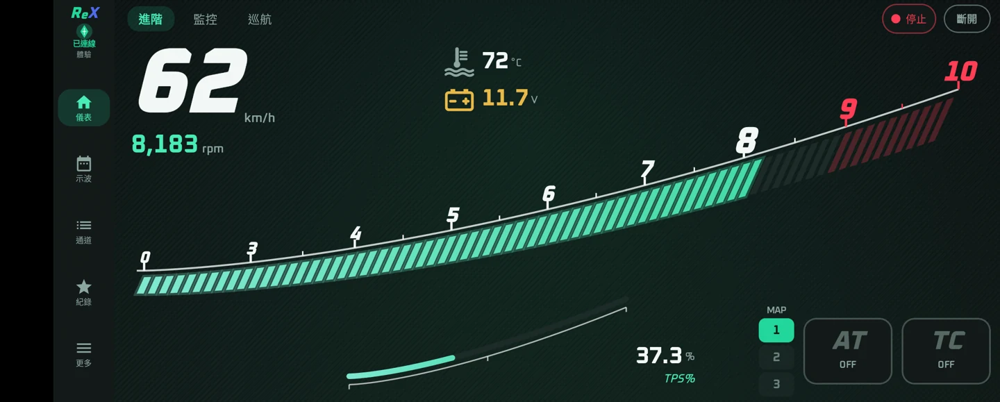
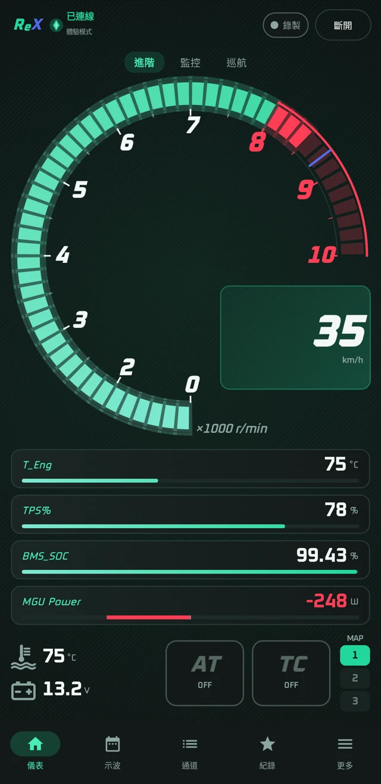
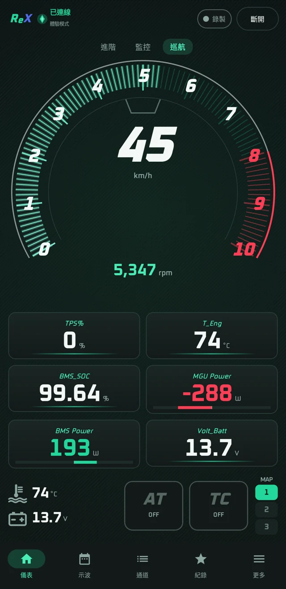
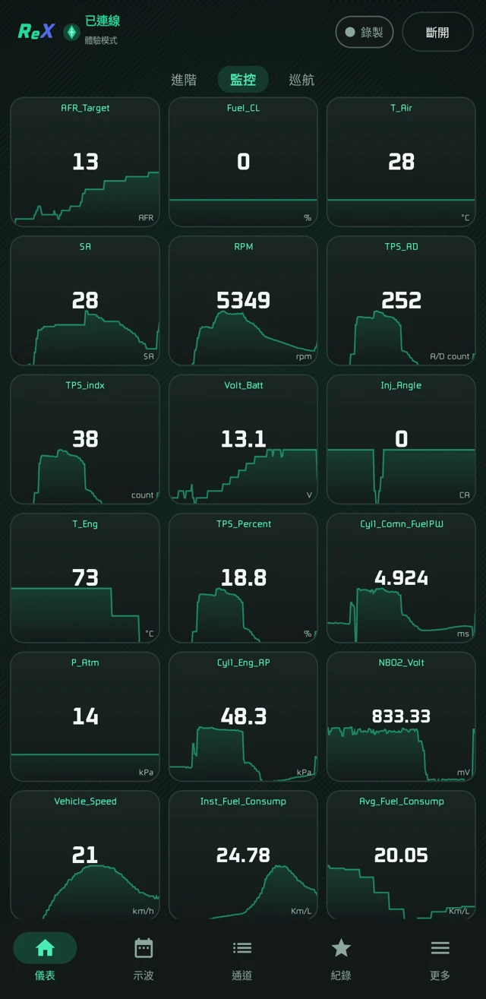
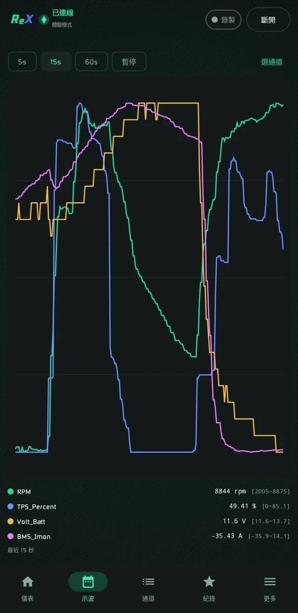
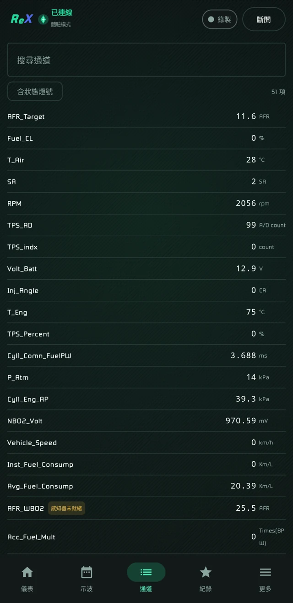
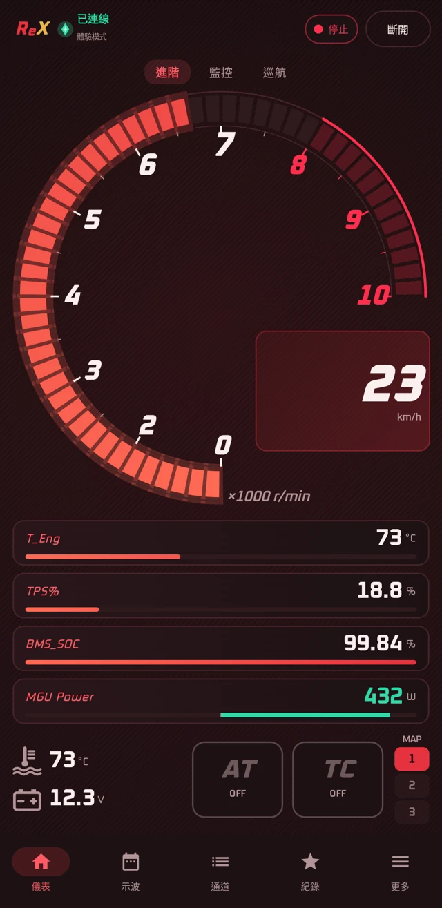
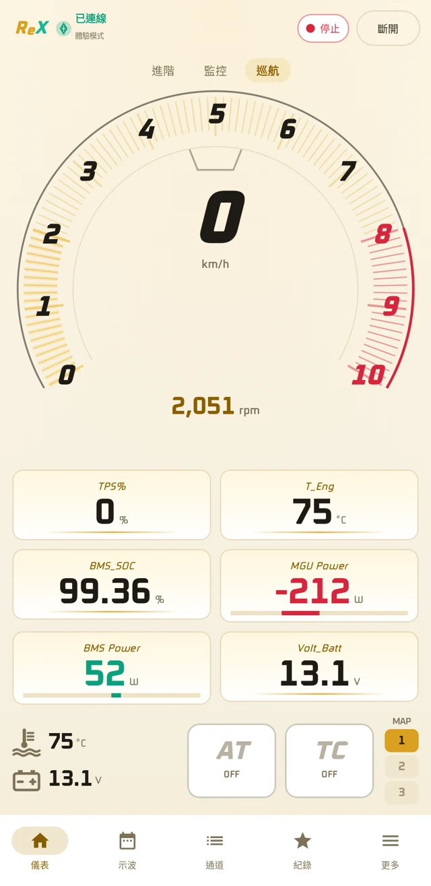
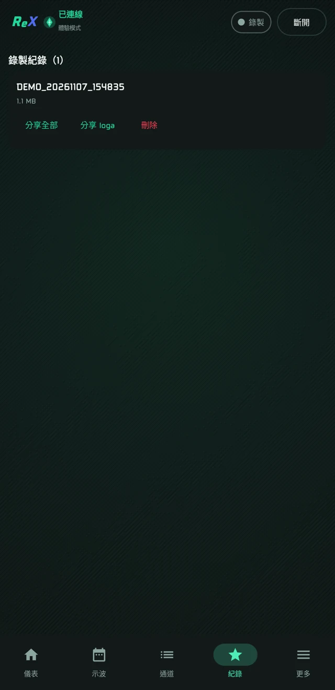
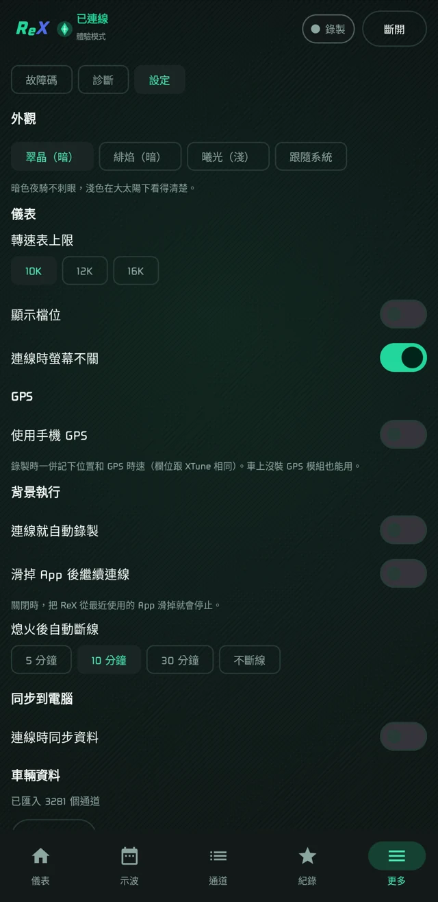

# ReX

繁體中文 | [English](README.en.md)

aRacer RC X 系列 ECU 的 Android／iOS 即時儀表與資料記錄 App。

**非官方**第三方工具，與 aRacer 無關。提供監控、記錄與儀表控制，不改調校表、密碼或韌體。



| 進階 | 巡航 | 監控 |
| :---: | :---: | :---: |
|  |  |  |

<details>
<summary>更多畫面</summary>

| 多通道示波 | 通道列表 |
| :---: | :---: |
|  |  |

| 暗色主題 | 淺色主題 |
| :---: | :---: |
|  |  |

| 錄製紀錄 | 設定 |
| :---: | :---: |
|  |  |

</details>

## 功能

- 三種儀表版面、最多 6 通道示波、通道列表與故障碼
- 錄製 `.loga`（與 XTune 相容），可離線重播
- 儀表控制 MAP／AT／Pit／LC／TC／EB（依 ECU 型號與授權）
- 自動尋找 ECU、斷線重連、手機 GPS 車速
- 介面：English、繁體中文、简体中文、日本語

## 開始使用

1. 從 [Releases](https://github.com/xeno-hf/ReX/releases) 下載 APK（iOS 需自行建置）。
2. 匯入你這顆 ECU 對應的 **ControlFile XML**。ReX 不附帶任何 aRacer 檔案，也不會從 XTune 自動取得。
3. 連上 ECU 的 Wi-Fi 開啟 ReX，或匯入 `.loga` 離線重播。

需求：Android 10+／iOS 15+。目前只有 Mini X 實車驗證過，其他型號尚未確認。

## 建置

需要 JDK 17+ 與 Android SDK（Platform 35）。

```sh
./gradlew :app:assembleRelease
```

未設定自己的簽章時，release 版會用 debug key 簽。

iOS 需要 macOS 與 Xcode，產出未簽章 IPA，請用自己的 Apple ID 簽章：

```sh
./rx-ios/app/build.sh device
```

## 安全

- 調校寫入、密碼變更、燒錄與韌體操作在送出前就會被擋下（`rx-session/src/commonMain/kotlin/rx/session/WriteGate.kt`）。
- 連線時會設定 ECU 的廣播通道；XTune 下次連線會自行寫回。
- 風險自負。騎車時請專心看路。

## 授權

GPL-3.0，見 [LICENSE](LICENSE)。字型 Oxanium 採 SIL Open Font License。商標聲明見 [NOTICE.md](NOTICE.md)。
