# ReX

繁體中文 | [English](README.en.md)

aRacer RC X 系列 ECU 的 Android／iOS 即時儀表、資料記錄與即時調校 App。

**非官方**第三方工具，與 aRacer 無關。平常只讀；只有按儀表控制鈕，或自己按下「開始調校」之後才會寫入 ECU。不改密碼、不燒錄韌體。

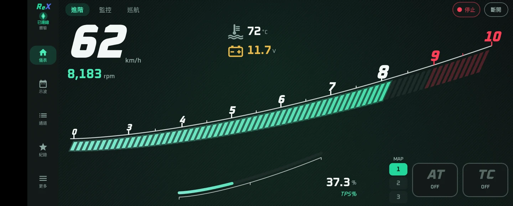

| 進階 | 巡航 | 監控 |
| :---: | :---: | :---: |
| 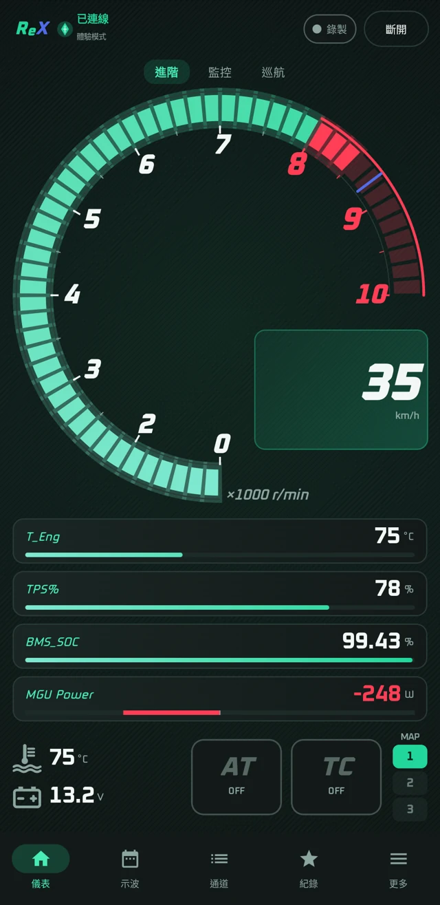 | 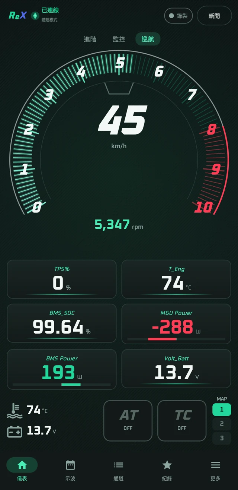 | 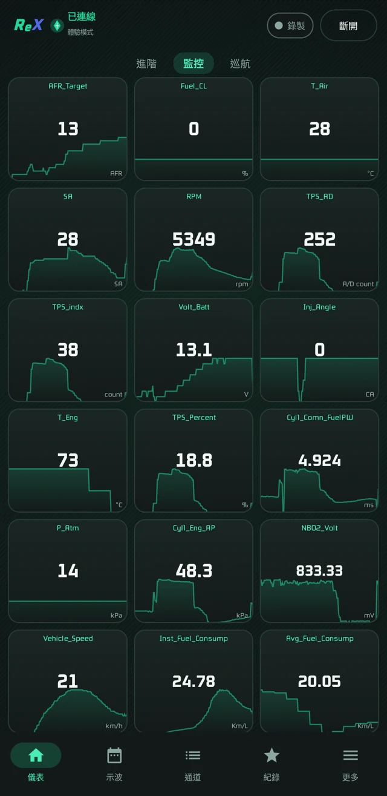 |

<details>
<summary>更多畫面</summary>

| 多通道示波 | 通道列表 |
| :---: | :---: |
| 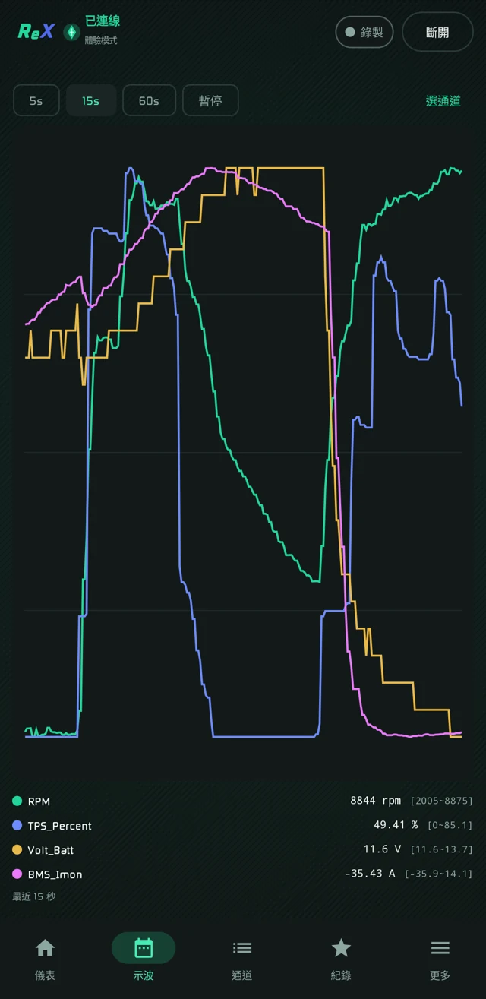 | 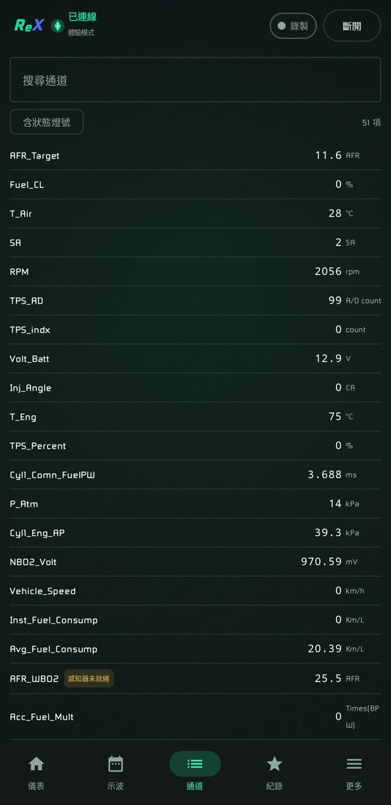 |

| 暗色主題 | 淺色主題 |
| :---: | :---: |
| 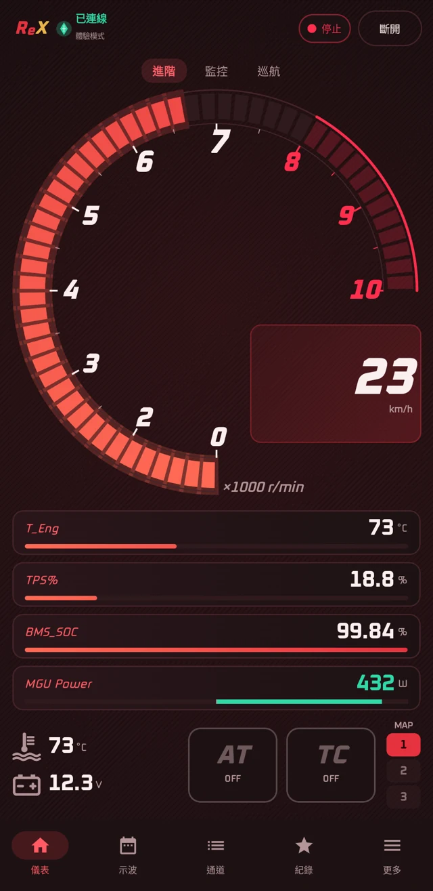 | 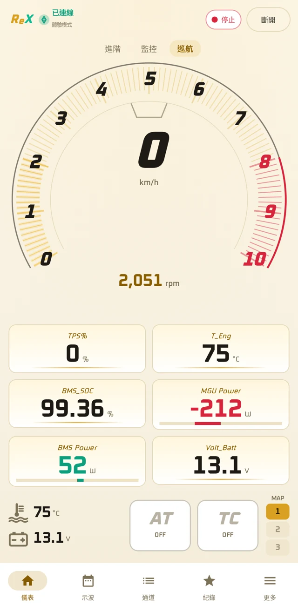 |

| 錄製紀錄 | 設定 |
| :---: | :---: |
| 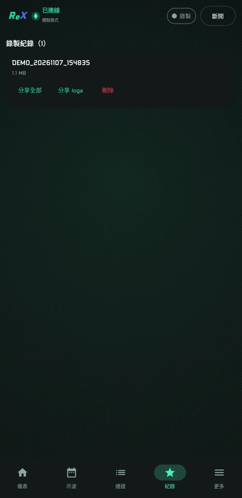 | 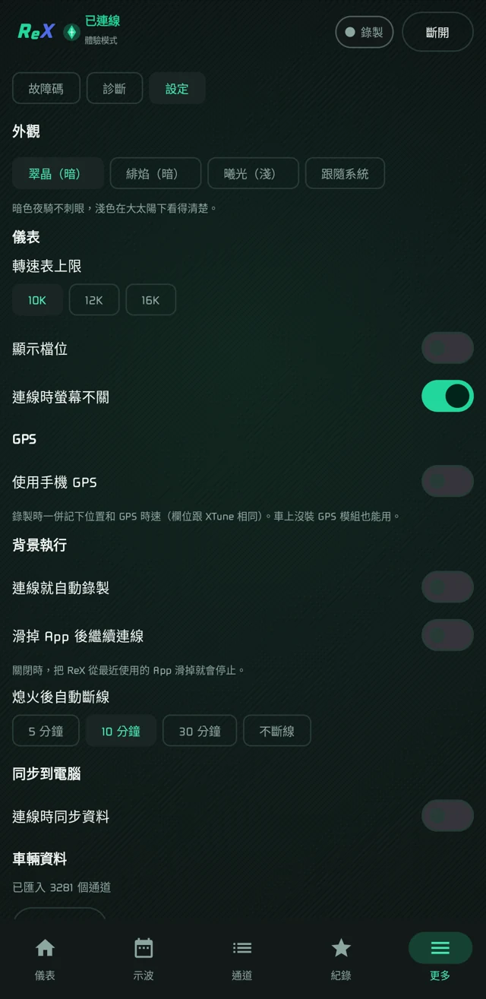 |

| 即時調校 | 選表 |
| :---: | :---: |
| 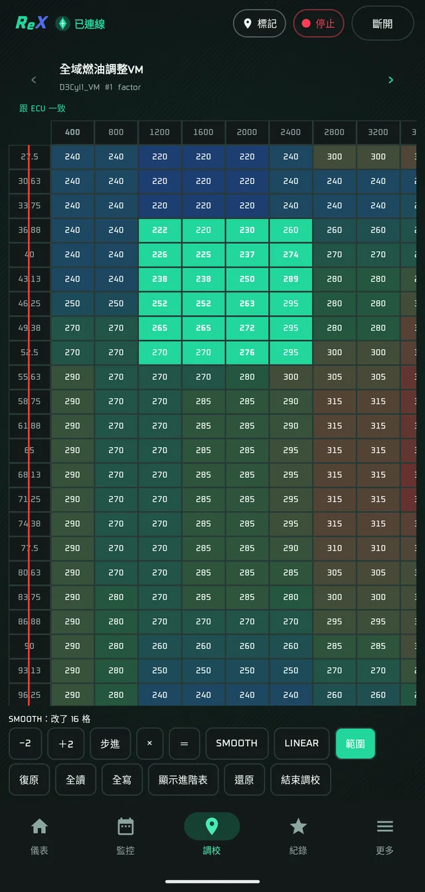 | 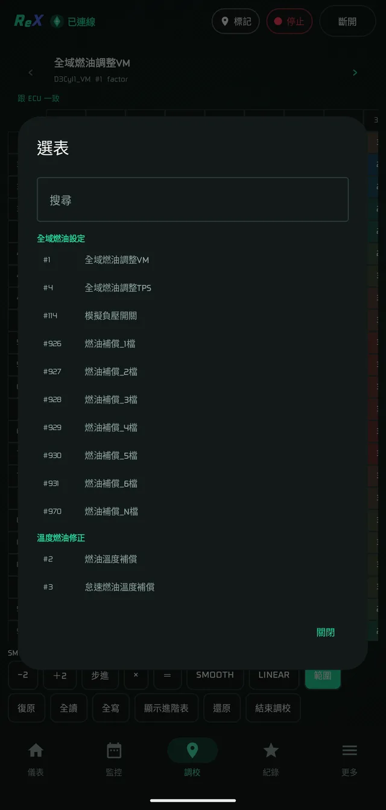 |

</details>

## 功能

- 三種儀表版面、最多 6 通道示波、通道列表與故障碼
- 錄製 `.loga`（與 XTune 相容），可離線重播
- 儀表控制 MAP／AT／Pit／LC／TC／EB（依 ECU 型號與授權）
- 即時調校：油圖、單值與開關，改完停手約 1.2 秒寫入並讀回確認；油圖上顯示引擎目前的位置
- 功能專頁：怠速、TPS 學習、快排、eBoost、回火、自動暖車、自動調校等（依 ECU 型號）
- 跟電腦版 [XenoBrex](https://github.com/xeno-hf/XenoBrex) 配對同步：取得調校包、上傳錄製（加密連線；目前只有 Android 版，iOS 版還不能同步，所以也還不能即時調校）
- 自動尋找 ECU、斷線重連、手機 GPS 車速
- 介面：English、繁體中文、简体中文、日本語

## 開始使用

1. 從 [Releases](https://github.com/xeno-hf/ReX/releases/latest) 下載 Android APK 或 iOS 未簽章 IPA。iOS 請先用 AltStore、Sideloadly 等工具，以自己的 Apple ID 簽署安裝；不需要自行編譯，IPA 不能直接點開安裝。
2. 連上 ECU 的 Wi-Fi，開啟 ReX 按連線。也可以匯入 `.loga` 離線重播。

ReX 內建各型號常用的監控通道，連線時會依 ECU 自動切換，不需要匯入任何檔案。想看完整通道的話，可以在設定裡另外匯入自己的 ControlFile XML。

即時調校需要調校包（表的定義）：在電腦裝 XenoBrex，匯入自己的定義檔後，用「更多 → 同步到電腦」跟 ReX 配對同步即可。ReX 不附定義檔與金鑰。

需求：Android 10+／iOS 15+（iPhone／iPad）。跟 XenoBrex 配對（以及需要它的即時調校）目前只有 Android 版。監控與儀表控制目前只有 Android 版搭配 Mini X 實車驗證過；iOS 實車連線、其他型號與**即時調校的實車寫入尚未驗證**。

## 建置

需要 JDK 17+ 與 Android SDK（Platform 35）。

```sh
./gradlew :app:assembleRelease
```

未設定自己的簽章時，release 版會用 debug key 簽。

iOS 需要 macOS 與 Xcode，產出未簽章 IPA，請用自己的 Apple ID 簽章：

```sh
./rx-ios/app/build.sh device
```

## 安全

- 每一個送出的幀都先過寫入閘門（`rx-session/src/commonMain/kotlin/rx/session/WriteGate.kt`）：平常只放行讀取與儀表控制；按下「開始調校」後才放行調校包裡的表與功能專頁的命令。密碼變更、燒錄與韌體操作一律擋下。
- 開始調校時先整份讀回 ECU，備份存好並讀回確認之後才放行寫入；備份存不起來就不開始。
- 調校包的平台、版本（V／C）與車種代號（Table ID）都要跟 ECU 一致才寫；斷線、重連或換了 ECU 會立刻收回寫入權限，要重新開始調校。
- ECU 拒絕的表不再送出。「還原」先關掉 ECU 的自動學習（自動調校、超級自動調校、寬域閉迴路）並確認已關，重讀開始時備份的每一張表，不同或不確定的逐列重寫並讀回確認，最後把自動學習恢復成備份時的設定；會列出沒能還原的表。
- 改表會直接改變引擎的行為。請在安全的地方、停車狀態下調校，改過的設定自己負責。
- 連線時會設定 ECU 的廣播通道；XTune 下次連線會自行寫回。
- 風險自負。騎車時請專心看路。

## 授權

GPL-3.0，見 [LICENSE](LICENSE)。字型 Oxanium 採 SIL Open Font License。商標聲明見 [NOTICE.md](NOTICE.md)。
