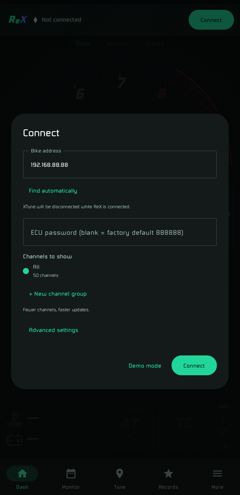
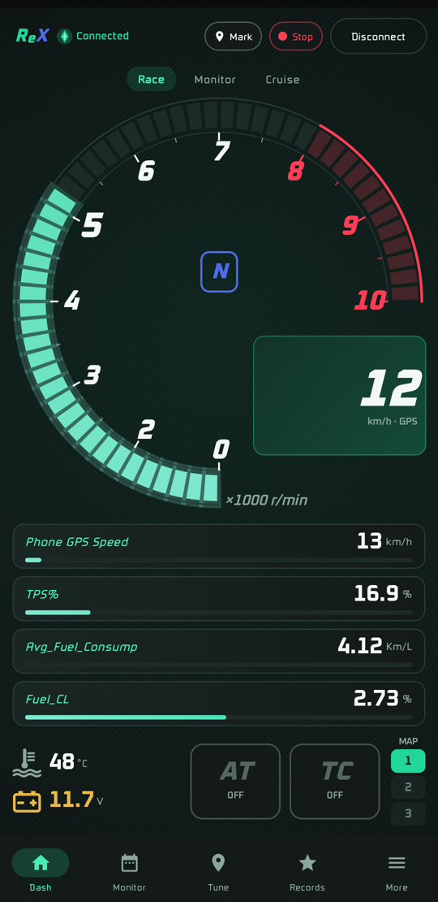
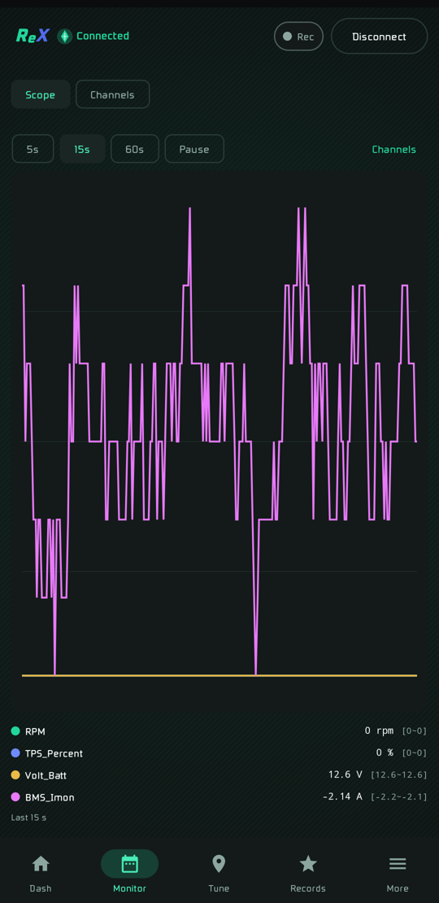
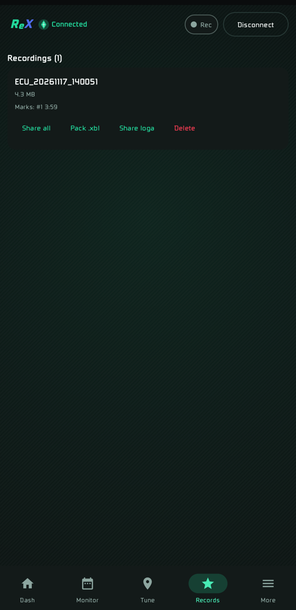
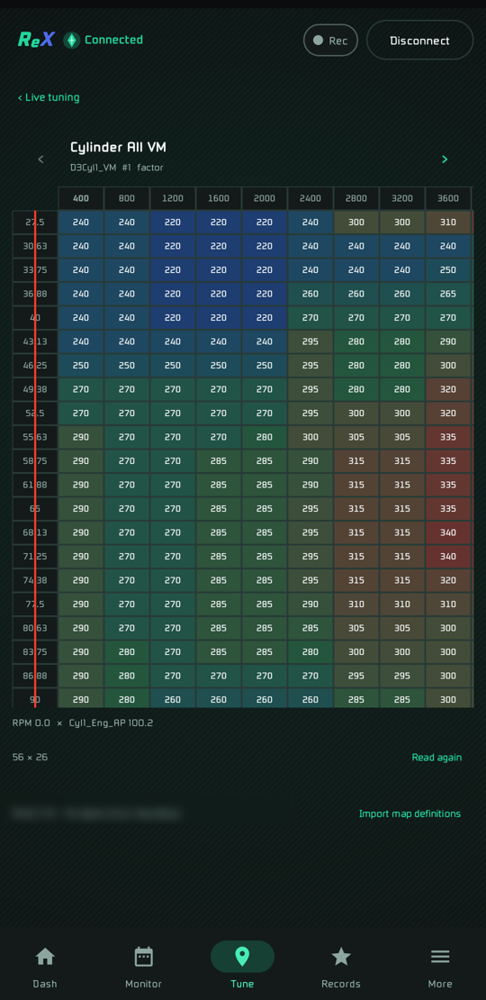

# Using ReX

[繁體中文](getting-started.md)

ReX is a phone app for aRacer RC X series ECUs: live dashboard, data recording and live tuning.

> It only reads by default. It writes to the ECU only when you press a dashboard control (AT, TC, MAP), or after you press "Start tuning" yourself. Monitoring and dashboard controls have only been verified on a real bike with the Android app and a Mini X; other models, iOS on a real bike, and live-tuning writes on a real bike are not yet verified.

## 1. Install

Download from [Releases](https://github.com/xeno-hf/ReX/releases/latest):

- **Android 10+**: download `ReX-x.y.z.apk` and install it. You can install over an older version; settings and recordings are kept.
- **iOS 15+**: `ReX-x.y.z-unsigned.ipa` is not signed and can't be installed by tapping it; sign it with your own Apple ID. On Windows the easiest tool is [Sideloadly](https://sideloadly.io):
  1. Install iTunes and iCloud from Apple's website (not the Microsoft Store versions), then install Sideloadly.
  2. Connect the iPhone by USB and tap "Trust" on the phone.
  3. Drag the IPA into Sideloadly, enter your Apple ID and press Start.
  4. On the iPhone, go to Settings → General → VPN & Device Management and trust your Apple ID. On iOS 16 or later, also turn on Settings → Privacy & Security → Developer Mode.
  5. With a free Apple ID the app stops opening after 7 days; sign it again the same way.

  The iOS app can show live data and record, but it can't sync with XenoBrex yet, so it can't tune live yet.

## 2. Connect

1. Connect the phone to the ECU's Wi-Fi (the same one XTune uses).
2. Open ReX and tap "Connect" at the top right:

- **Bike address**: `192.168.88.88` by default. If your ECU uses a different address, tap "Find automatically".
- **ECU password**: leave it blank if you never changed it (factory default `888888`).
- **Channels to show**: "All" by default. Use "New channel group" to pick only the channels you want; fewer channels update faster.
- XTune is disconnected while ReX is connected; the ECU accepts only one connection at a time.
- No bike nearby? Tap "Demo mode" to look around.

## 3. Dashboard and monitor

The tabs at the bottom:

- **Dash**: RPM, speed and other values. Switch between Race, Monitor and Cruise styles at the top. The AT, TC and MAP buttons are controls and **write to the ECU** when pressed; which ones appear depends on the ECU model.
- **Monitor**: "Scope" shows values over time; "Channels" shows every channel's live value.

 

## 4. Record and share

- Tap "Rec" at the top to start, and again to stop. Tap "Mark" during a ride to mark a moment.
- In the "Records" tab you can:
  - **Share loga**: an XTune-compatible log
  - **Pack .xbl**: the ride, vehicle model and live-tuning write log in one file that XenoBrex can read
  - **Share all**, **Delete**
- To replay your own recording: disconnect first, then choose it from Connect → Demo mode.

> A loga contains your phone's GPS columns. Before sharing it with others or uploading it publicly, remember it may contain your route.

## 5. Tuning and maps (Android)

Tuning needs your own definitions: import them in [XenoBrex](https://github.com/xeno-hf/XenoBrex) on your computer, then pair ReX in More → "Sync to computer" with the pairing code. ReX then gets the tuning pack and map definitions from XenoBrex. ReX does not include definitions or keys.

- **Tune** tab: tables with a cursor show which cell the engine is running in right now.
- Nothing is written until you press "Start tuning". It first reads the whole ECU back and saves a backup; after that each edit is written about 1.2 s after you stop and read back to confirm. You can write the backup back with one tap at any time.

Changing tables changes how the engine runs. Tune with the bike stopped; you are responsible for your settings.

## Questions?

- Questions, ideas, sharing: [Discussions](https://github.com/xeno-hf/ReX/discussions)
- A confirmed bug: an [Issue](https://github.com/xeno-hf/ReX/issues), with a screenshot, and a loga if you can.
