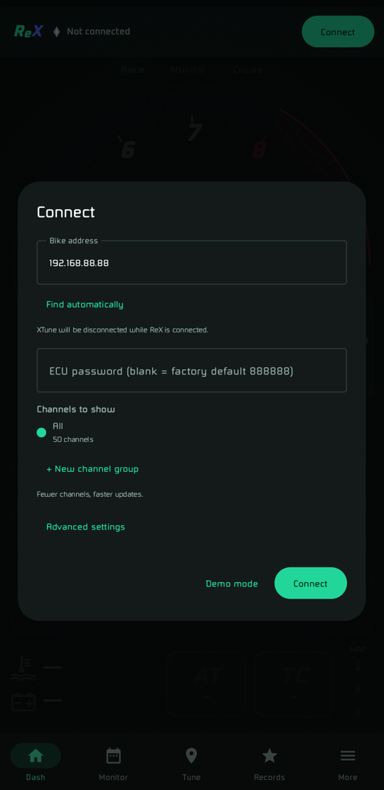
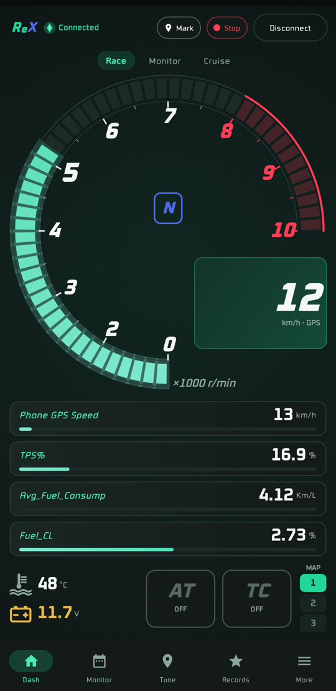
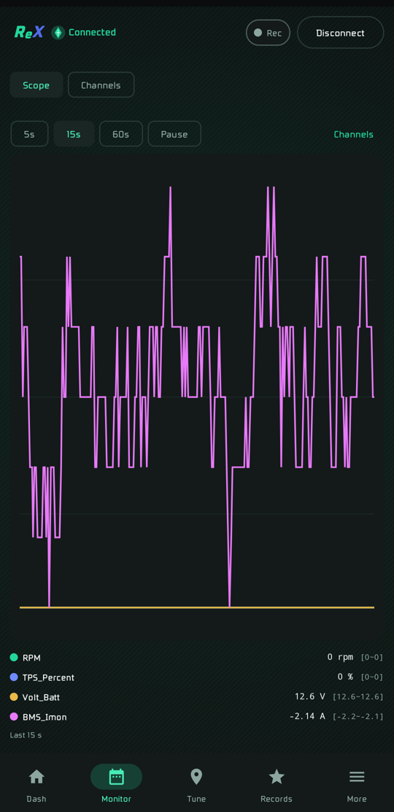
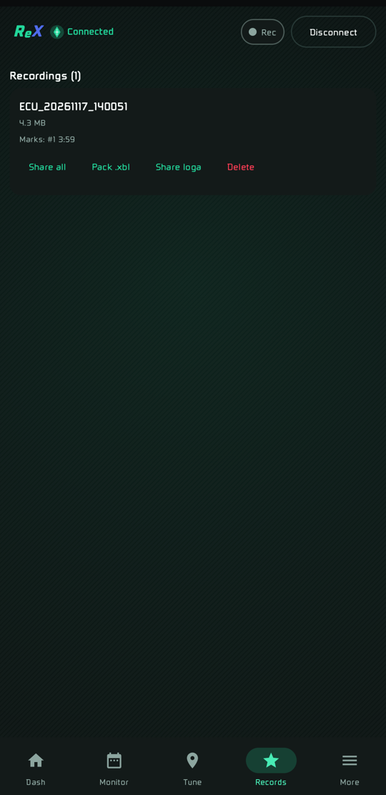
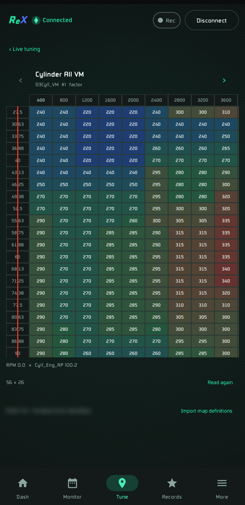

# ReX 使用教學

[English](getting-started.en.md)

ReX 是 aRacer RC X 系列 ECU 的手機即時儀表、資料記錄與即時調校 App。

> 平常只讀。只有按儀表上的控制鈕（AT、TC、MAP），或自己按下「開始調校」之後，才會寫入 ECU。監控與儀表控制目前只在 Android 版搭配 Mini X 實車驗證過；其他型號、iOS 實車連線，以及即時調校的實車寫入尚未驗證。

## 1. 安裝

到 [Releases](https://github.com/xeno-hf/ReX/releases/latest) 下載：

- **Android 10 以上**：下載 `ReX-x.y.z.apk` 直接安裝。可以直接覆蓋舊版，設定和紀錄會保留。
- **iOS 15 以上**：`ReX-x.y.z-unsigned.ipa` 沒有簽章，不能直接點開安裝，要用自己的 Apple ID 簽署。Windows 上最簡單的是 [Sideloadly](https://sideloadly.io)：
  1. 從 Apple 官網安裝 iTunes 和 iCloud（不要用 Microsoft Store 版），再安裝 Sideloadly。
  2. iPhone 用 USB 接電腦，手機上按「信任」。
  3. 把 IPA 拖進 Sideloadly，輸入 Apple ID，按 Start。
  4. iPhone 上到「設定 → 一般 → VPN 與裝置管理」信任你的 Apple ID；iOS 16 以上還要打開「設定 → 隱私權與安全性 → 開發者模式」。
  5. 免費 Apple ID 簽的 App 7 天後會打不開，照同樣步驟重簽即可。

  iOS 版目前可以看即時資料和錄製，還不能跟 XenoBrex 同步，所以也還不能即時調校。

## 2. 連線

1. 手機連上 ECU 的 Wi-Fi（跟 XTune 用的同一個）。
2. 打開 ReX，按右上角「連線」：

- **車子的位址**：預設 `192.168.88.88`。如果你的 ECU 位址不同，可以按「自動尋找」。
- **ECU 密碼**：沒改過的話留空，就是出廠的 `888888`。
- **要看的通道**：預設「全部」。可以「新增通道組」只挑自己要看的，通道越少，更新越快。
- ReX 連線時 XTune 會被斷開，ECU 一次只接受一個連線。
- 沒有車也想先看看介面：按「體驗模式」。

## 3. 儀表與監控

下方的分頁：

- **儀表**：轉速、車速、各項數值。上方可切換「進階／監控／巡航」三種樣式。下方的 AT、TC、MAP 是控制鈕，**按了會寫入 ECU**，依 ECU 型號顯示。
- **監控**：「示波」看數值隨時間變化，「通道」看所有通道的即時值。

 

## 4. 錄製與分享

- 按上方的「錄製」開始，再按一次停止；騎乘中可以按「標記」記下特別的時間點。
- 「紀錄」分頁可以：
  - **分享 loga**：XTune 相容的紀錄檔
  - **打包 .xbl**：騎乘紀錄＋車輛型號＋即時調校的寫入紀錄，XenoBrex 可以直接讀
  - **分享全部**、**刪除**
- 想重播自己的紀錄：先斷開連線，再從「連線 → 體驗模式」選擇。

> loga 裡有手機 GPS 的欄位。分享給別人或公開上傳之前，請留意裡面可能有你的行車路線。

## 5. 調校與油圖（Android）

調校需要你自己的定義檔：在電腦上用 [XenoBrex](https://github.com/xeno-hf/XenoBrex) 匯入，再到 ReX「更多 → 同步到電腦」用配對碼配對，就能從 XenoBrex 取得調校包和油圖定義。ReX 不附定義檔與金鑰。

- **調校** 分頁：有準星的表會即時標出引擎目前在哪一格。
- 按「開始調校」後才會寫入：會先整份讀回 ECU 並存一份備份，之後改的值停手約 1.2 秒寫入並讀回確認，隨時可以用備份一鍵寫回。

改表會直接改變引擎行為，請在停車狀態下調校，改過的設定自己負責。

## 有問題？

- 問題、想法、心得：[Discussions](https://github.com/xeno-hf/ReX/discussions)
- 確定是程式錯誤：[Issue](https://github.com/xeno-hf/ReX/issues)，附上截圖；方便的話也附上 loga。
